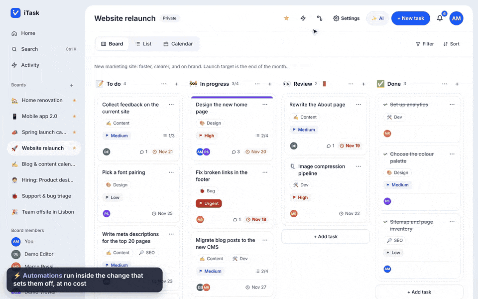
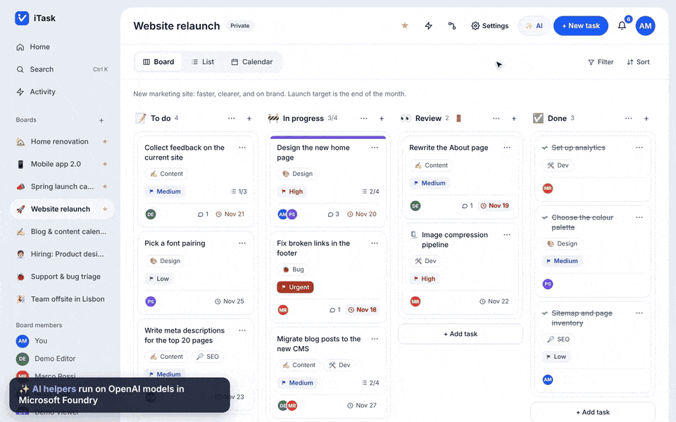

# iTask

A board-and-card task manager: **ASP.NET Core 10** API, **Vue 3** frontend,
and **Azure** infrastructure in **Bicep**, designed to run for near $0: free tiers,
scale-to-zero and a $2 budget kill switch.

<p align="center"></p>

<p align="center"><em>Automations on the sample board: describe a rule, replay it, review the board, watch a doorway block a move, then see a rule assign, label and comment on a bug and one Undo revert all three.</em></p>

## AI and automations

### ✨ AI helpers

OpenAI models deployed in **Microsoft Foundry**, called from the API through `IAiService`
(`Infrastructure/Ai`) with the API's managed identity and structured JSON outputs. Every answer
comes back as an editable draft with Accept or Discard; nothing is written until the user accepts it.

| Helper | Where | What it returns |
|---|---|---|
| Quick add | ✨ AI › Quick add | A sentence becomes a task draft: title, due date, priority, labels and list |
| Break down | Card › ✨ Break down | Up to 12 checklist steps, minus the ones the card already has |
| Summarize | Card › ✨ Summarize | Description, comments and activity in one paragraph, optionally posted as a comment |
| Daily digest | ✨ AI › Daily digest | What is due, stuck and done on the board |
| From a goal | New board › From a goal | Lists and starter cards with checklists |

Limits: editors and owners only, not for demo accounts (register a free account to try AI),
10 requests per user and 30 for the whole
app per UTC day (`Ai__DailyRequestsPerUser`, `Ai__DailyRequestsTotal`). AI is off until
`AI_ENDPOINT` and `AI_DEPLOYMENT` are set.

<p align="center"></p>

<p align="center"><em>Quick add, Break down, Summarize and the Daily digest. Each result is a draft until accepted.</em></p>

### ⚡ Automations

Automations run inside the request that changes the card (`Common/Automations`), so an instant
rule needs no queue, worker or extra Azure service. Date triggers run in the hourly maintenance job.

- **List doorways (🚪):** requirements for entering or leaving a list (assignee, label, due date,
  finished checklist, priority). A doorway can **block** the move and say what is missing (owners can
  move anyway, which is recorded), **fill in** what is missing, or **warn** on the column.
- **Rules (⚡):** *when* a trigger fires, *if* the conditions hold, *then* run up to three actions
  (move, complete, reopen, labels, assign, priority, due date, checklist items, comment, notify, archive).
- **Explain and undo:** automated changes appear as "(⚡ rule)" in the activity feeds with an Undo
  toast, and they never set off other automations.
- **Replay before adding:** shows how often a draft rule would have run in the last 30 days.
- **Show me once:** record the steps on one card and get a rule draft.
- **✨ Describe it / Review my board:** draft a rule from plain words, or get up to three
  suggestions from the board's activity counts (no card text is sent). A rule can also carry one
  ✨ action (break down, pick labels and priority, or summarize), charged to its creator's quota.

## Architecture


- **Web:** Vue 3 + TypeScript PWA on Static Web Apps (Free). Boards opened once stay readable offline.
- **API:** ASP.NET Core 10 minimal API in vertical slices on Container Apps (consumption, scales to
  zero, one replica because SignalR live updates and presence are in-process). The automation
  engine, the AI gateway (quotas, prompts, answer validation) and the hourly jobs run here.
- **Data:** Azure SQL Database free offer with auto-pause through EF Core; SQLite locally.
  Attachments live in Blob Storage and are served through short-lived user delegation SAS links.
- **Identity:** the API reaches SQL, Blob Storage and Foundry with a user-assigned managed identity.
  No passwords, storage keys or model keys in config.
- **Delivery:** GitHub Actions builds and tests, pushes the image to GHCR and deploys Bicep with
  OIDC after a manual approval. A budget with a Logic App kill switch stops the API if spend passes the cap.

## About this revamp

This repository is the revamp of the legacy iTask app, a Laravel 5.2 project from
2020 (`itask-legacy`). It keeps the same idea, boards with lists
and cards, labels, checklists, comments, attachments and an activity log, and
rebuilds it with a modern stack, proper authorization and cloud hosting. Compared
with the legacy app it adds:

- authorization on every board route, with Owner, Editor and Viewer roles per board
- attachments scoped to their card and stored in Blob Storage instead of local disk
- persisted ordering of lists and cards
- automated tests, CI/CD and infrastructure as code

## Versions

The project tracks **Long Term Support** releases only:

| Component | Version | Notes |
|---|---|---|
| .NET | 10 (LTS) | `backend/global.json` pins the 10.0 SDK band; Dependabot ignores major .NET bumps (STS releases such as .NET 11). The next move is to the next LTS. |
| Node.js | 22 (LTS) | Used by the frontend toolchain and CI. |

```
backend/    ASP.NET Core minimal API, vertical slices (see backend/README.md)
frontend/   Vue 3 + Vite + TypeScript, feature-first (see frontend/README.md)
infra/      Bicep: bootstrap/ (one-time, run by the owner) and main.bicep (deployed by CI)
.github/    ci-reusable.yml, ci.yml (pull requests), ci-cd.yml (main + deploy)
```

## Versioning

Releases follow [Semantic Versioning](https://semver.org): `MAJOR.MINOR.PATCH`.

| Part | Bump when | Example |
|---|---|---|
| **MAJOR** (1st digit) | a change breaks compatibility: API contract, data model or behavior existing users rely on | `1.4.2` → `2.0.0` |
| **MINOR** (2nd digit) | a new feature is added in a backward-compatible way | `1.4.2` → `1.5.0` |
| **PATCH** (3rd digit) | a backward-compatible bug or security fix | `1.4.2` → `1.4.3` |

- Versions below `1.0.0` are pre-release; `1.0.0` is the first production release (the MVP).
- Releases are git tags `vMAJOR.MINOR.PATCH` (e.g. `v1.2.0`) with release notes.
- The API (`backend/Directory.Build.props`, `<Version>`) and the frontend
  (`frontend/package.json`, `version`) carry the same version.

## Develop

Works the same on a laptop, in a dev container / Codespaces, or in a cloud sandbox:
no database server or cloud account is needed for day-to-day work.

**Requirements:** .NET SDK 10, Node 22+. (Or open the repo in the dev container.)

```sh
# API on http://localhost:5080 (SQLite file, schema created automatically)
cd backend
dotnet user-secrets --project src/ITask.Api set "Demo:Password" "<choose one>"   # optional demo accounts
dotnet run --project src/ITask.Api

# Frontend on http://localhost:5173 (proxies /api to the API)
cd frontend
npm ci
npm run dev
```

Tests: `dotnet test` in `backend/`, `npm run test:unit` and `npm run test:e2e` in `frontend/`.

Want SQL Server locally for parity with Azure SQL? See `docker-compose.yml`.

## Roles

iTask has two separate layers of roles. App roles decide who manages accounts; board roles
decide what someone can do on one board. Neither grants the other.

### App level: User and Platform admin

Everyone who registers is a **User**. The first **Platform admin** comes from the
`PLATFORM_ADMIN_EMAILS` secret (see setup below); after that, admins promote others on
**Admin › Users**.

| Action | User | Platform admin |
|---|:-:|:-:|
| Create boards, join boards by invite, use their own boards | ✓ | ✓ |
| Edit their own profile and password | ✓ | ✓ |
| Open **Admin › Users**: list every account in iTask (name, email, join date, user type, demo and locked status) | | ✓ |
| Lock or unlock an account (a locked user is signed out within a minute and can't sign in) | | ✓ |
| Change an account's user type (User or Platform admin) | | ✓ |
| Open a board they aren't a member of | | |

Admin limits: admins can't lock themselves or change their own user type, so at least one
admin always remains. Demo accounts keep their seeded type, and the demo admin can't change
anyone's type. A new user type reaches that person's session within a minute, without
signing them out.

### Board level: Owner, Editor and Viewer

Whoever creates a board is its **Owner**; Owners invite others as Owner, Editor or Viewer.

| Action on a board | Viewer | Editor | Owner |
|---|:-:|:-:|:-:|
| See the board, lists, cards, files and activity | ✓ | ✓ | ✓ |
| Star the board, see its members | ✓ | ✓ | ✓ |
| Comment; edit or delete their **own** comments | ✓ | ✓ | ✓ |
| Create, edit, move, complete and archive cards and lists | | ✓ | ✓ |
| Subtasks, labels, assignees and dates | | ✓ | ✓ |
| Upload files; delete their **own** files | | ✓ | ✓ |
| Delete **anyone's** comments or files | | | ✓ |
| Invite people, change roles, remove members | | | ✓ |
| Board settings, archive, restore and delete | | | ✓ |

Board rules: any member can leave a board, but the last Owner can't leave or be removed.
Nothing can change on an archived board until an Owner restores it. People who aren't
members get "not found" rather than "forbidden", so a private board's existence stays hidden.

### Demo accounts

Demo environment only: one account per role (Platform admin, Owner, Editor, Viewer) on a
shared sample board, reset nightly. Demo accounts can't change passwords, upload files or
use admin actions that change other accounts.

AI features are turned off for demo accounts, because the logins are shared and every AI
request is billed to the deployment. To try AI, register your own account (email
verification required): it can use the AI helpers on any board where it is an Editor or
Owner (including boards it creates), within the daily limits above.

## CI/CD

| Workflow | Runs on | Does |
|---|---|---|
| `ci.yml` | pull requests to `main` | calls `ci-reusable.yml`: build, test, lint, Bicep lint, CodeQL |
| `ci-cd.yml` | manual (Run workflow) | calls `ci-reusable.yml`, then **deploy** after the owner approves |

The deploy job signs in to Azure with **OIDC** (no stored cloud secret), pushes the
API image to GHCR, deploys `infra/main.bicep`, and publishes the frontend to Static Web Apps.
Unchanged parts are skipped: the API image is tagged with the git tree hash of `backend/`
and isn't rebuilt when that tag is already on GHCR, and the site isn't rebuilt or uploaded when
its live `build-id.txt` (a hash of `frontend/`, the API URL and the Turnstile site key) already
matches. **Run workflow** has an `infra` choice: `full` (default) runs Bicep, which also copies
the `production` secrets to the container app; `app-only` only swaps the API image and is for
code-only changes (it does not apply changed secrets or `infra/`).
After a successful deploy, the **release** job tags the commit `vX.Y.Z` (the `<Version>` in
`backend/Directory.Build.props`) and publishes a GitHub release whose notes are that
version's section of `CHANGELOG.md` plus the merged pull requests. Deploying the same
version again leaves the existing release alone, so bump the version (and add its
CHANGELOG section) for each release.

## First-time Azure setup (owner only)

1. **Bootstrap** (creates `rg-itask`, identities, the GitHub OIDC trust, role
   assignments, a $2 budget and the budget kill switch). Re-run it after changes to
   `infra/bootstrap/`:
   ```sh
   az login
   export ITASK_ALERT_EMAIL=<your email>
   az deployment sub create --location southeastasia \
     --template-file infra/bootstrap/bootstrap.bicep \
     --parameters infra/bootstrap/bootstrap.bicepparam
   ```
2. **GitHub → Settings → Environments → New environment `production`:** add yourself
   as a required reviewer and limit deployment branches to `main`. Add these
   **environment secrets** (stored as Container Apps secrets on each deploy):
   - `DEMO_PASSWORD`: password of the demo accounts (empty = demo sign-in off)
   - `TURNSTILE_SECRET_KEY`: Cloudflare Turnstile secret key. **Needed for sign-up and
     sign-in:** in production the check fails closed, so password sign-in, registration,
     password reset and new sign-up codes are refused until it is set (demo, GitHub and
     Microsoft sign-in still work). The widget needs the site hostname, so add it right
     after the first deploy.
   - `PLATFORM_ADMIN_EMAILS`: emails (`;` separated) made Platform admin at startup and
     when they register. Kept as a secret so the addresses stay out of public run logs.
     Removing an email later does not demote the account; use Admin › Users for that.
   - `SMTP_USERNAME` / `SMTP_PASSWORD`: a Gmail address and its
     [app password](https://myaccount.google.com/apppasswords) (needs 2-Step Verification)
     used to send sign-up codes, invites, password resets and digests. Use a dedicated
     account: recipients see the address. **Needed for sign-up:** new accounts must enter
     the emailed 6-digit code, so without SMTP nobody can finish registering (production
     never logs email bodies). iTask sends at most 400 emails a day and 10 per address.
   - `AZURE_CLIENT_ID` (bootstrap output `deployClientId`), `AZURE_TENANT_ID`,
     `AZURE_SUBSCRIPTION_ID`: required, used by the OIDC sign-in. Secrets so the ids stay
     out of public run logs.
   - `SQL_ADMIN_GROUP_ID`: optional Entra group used as SQL admin (see below).
   - `AI_ENDPOINT` / `AI_DEPLOYMENT`: optional, see step 6.
3. **GitHub → Settings → Secrets and variables → Actions → Variables:** only values that
   are public by design: optionally `TURNSTILE_SITE_KEY` (shipped in the site) and the
   OAuth client ids from step 5.
4. **Actions → ci-cd → Run workflow** on `main`, approve the deploy. After the first
   run, make the `itask-api` package on GHCR **public** so Azure can pull it without
   credentials (it contains no secrets), then run the workflow again.
5. **Sign in with GitHub or Microsoft (optional, free).** Each button appears only once its
   client id and secret are set. Use the API URL from the deploy output (`apiUrl`):
   - **GitHub:** Settings → Developer settings → OAuth Apps → New OAuth App. Homepage = the
     site URL, callback = `<apiUrl>/api/auth/signin-github`. Save the client id as the
     variable `GH_OAUTH_CLIENT_ID` and a client secret as the `production` secret
     `GH_OAUTH_CLIENT_SECRET` (GitHub reserves names starting with `GITHUB_`).
   - **Microsoft:** Entra admin center → App registrations → New registration, account types
     "Any Entra ID tenant + personal Microsoft accounts", Web redirect URI
     `<apiUrl>/api/auth/signin-microsoft`. Save the application (client) id as the variable
     `MICROSOFT_CLIENT_ID` and a client secret as the `production` secret
     `MICROSOFT_CLIENT_SECRET` (secrets expire: note the date).
   - Run ci-cd again. New accounts need a verified email from the provider. An existing account
     is joined automatically only when its email is confirmed; otherwise the user signs in with
     the password and connects the provider from Profile.
   - Locally: create a second GitHub OAuth app with callback
     `http://localhost:5080/api/auth/signin-github`, then
     `dotnet user-secrets set Auth:GitHub:ClientId <id>` (and `Auth:GitHub:ClientSecret`) in
     `backend/src/ITask.Api`.
6. **AI features (optional, pay per token).** In the Azure portal create a Microsoft Foundry
   resource in `rg-itask` and deploy a small chat model from Azure OpenAI in Foundry Models (for example
   `gpt-4.1-mini`) with a low tokens-per-minute quota. The API identity already has
   the built-in role "Cognitive Services OpenAI User" on the resource group, so no key is needed. Save the
   endpoint (`https://<name>.openai.azure.com/`) as the `production` secret `AI_ENDPOINT`
   and the deployment name as the `production` secret `AI_DEPLOYMENT` (secrets keep the
   resource name out of the public workflow logs), then run ci-cd again. Nothing bills until a user
   presses a ✨ button; each user gets 10 AI requests a day, 30 for the whole app (`Ai__DailyRequestsPerUser`, `Ai__DailyRequestsTotal`).
   Locally: `dotnet user-secrets set Ai:Enabled true` plus `Ai:Endpoint` and `Ai:Deployment`,
   signed in with `az login`.

### Operations

- **Health:** liveness `/api/health`, readiness `/api/health/ready` (checks the database).
- **Maintenance:** the API runs daily jobs (03:00 UTC slot): demo reset, activity older
  than 180 days, notifications past retention, uploads that were never confirmed. Hourly
  jobs send due-soon/overdue reminders and the email digests (08:00 in each user's time
  zone), and create the next copy of repeating cards. With the API scaled to zero, a missed
  slot runs on the next start, so reminders, digests and repeats can arrive late (a long
  pause makes one copy, not one per missed date). Jobs take a database lock, so only one replica runs each.
- **Live updates:** boards stay in sync over SignalR (`/api/hubs/board`, cookie auth,
  WebSockets through the Container Apps ingress). Groups and presence live in the API
  process, so the API runs at most 1 replica. An open connection counts as a request and
  keeps the replica awake, so the site only connects on a board page and disconnects
  when the tab is hidden or idle for 10 minutes; the API can still scale to zero. For
  more replicas, set `Realtime__AzureSignalR=true` and `Azure__SignalR__ConnectionString`
  (Azure SignalR Service Free: 20 connections, 20,000 messages a day).
- **Budget kill switch:** when the $2 budget is spent, the action group runs the
  `logic-itask-killswitch` Logic App, which stops the API. Start it again with
  `az containerapp start -g rg-itask -n ca-itask-api`.
- **Manual SQL queries:** the SQL admin is the API identity. To query yourself, create
  an Entra group (for example `itask-sql-admins`), add yourself and `id-itask-api`,
  set its object id as the `SQL_ADMIN_GROUP_ID` `production` secret and redeploy. Then connect
  with Entra authentication (Azure Data Studio, `sqlcmd -G`) after allowing your IP
  in the SQL server firewall.
- **Custom domain (optional):** without one, the site and API are different sites, so
  the auth cookie is `SameSite=None; Partitioned` and the API rejects writes from
  foreign origins. Browsers that block all third-party cookies (Safari by default)
  can't sign in until the site and API share a domain (`app.` and `api.` of the same
  domain); then set `crossSiteCookies = false` in `infra/main.bicepparam`.

## Repository settings (owner checklist)

- Ruleset on `main`: require a pull request, require your approval, require the `ci`
  checks, block force pushes and deletion.
- Actions → General: workflow permissions **read-only**; require approval for **all
  outside collaborators**; allow only GitHub-owned and verified actions.
- Code security: enable secret scanning, **push protection**, Dependabot alerts and
  private vulnerability reporting.

## Cost guardrails

Near $0, not guaranteed $0. Free tiers where they exist (Static Web Apps Free, Azure SQL
free offer set to pause instead of bill, images on GitHub Container Registry), Container Apps
consumption scaling from 0 to 1 replica within its monthly free grant, and pay-per-use items
kept to pennies (Blob Storage, Foundry tokens under per-user and app-wide AI caps, Log
Analytics with a 0.1 GB daily cap). A $2 subscription budget emails alerts and triggers the
kill switch that stops the API; cost data lags by hours, so it is a safety net rather than a
real-time cap. Rate limiting in the API adds abuse protection. See `SECURITY.md` for the security model.

Abuse limits (all free, set in configuration, counted per UTC day in the database):

| Limit | Default | Setting |
|---|---|---|
| New accounts (email code required) | 50 / day | `Auth__DailySignups` |
| Unconfirmed accounts kept | 24 h | `UnverifiedAccountsJob` |
| AI requests | 10 per user, 30 in total / day | `Ai__DailyRequestsPerUser`, `Ai__DailyRequestsTotal` |
| Emails | 400 / day, 10 per address / day | `Email__DailyLimit`, `Email__DailyPerRecipient` |
| File storage | 100 MB per user, 2 GB in total | `Storage__QuotaBytesPerUser`, `Storage__QuotaBytesTotal` |
| Upload links | 50 per user / day | `Storage__UploadUrlsPerUserPerDay` |
| Boards and cards | 50 owned boards per user, 2,000 cards per board | `Board.MaxOwnedPerUser`, `Card.MaxPerBoard` |
